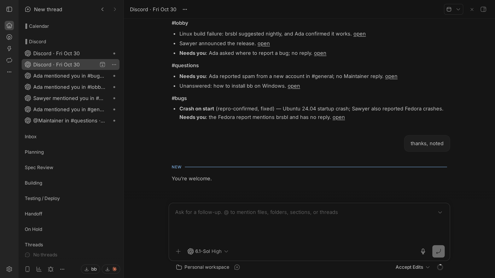

# Discord

Puts your Discord tags and a daily channel summary in a **💬 Discord** section of the sidebar, right below 📅 Calendar. It reads one server through a bot you add to it, and never posts, reacts or changes anything in Discord.



## Install

```bash
bb plugin install git:https://github.com/brsbl/bb-plugins.git@plugin/discord-inbox --yes
```

## Use

### Set up

1. Add a bot to your server with the **Message Content** intent and permission to read the channels you want. It needs no other permissions.
2. In **Settings → Discord**, save the bot token, the server ID and your own Discord user ID.
3. Optionally change the Maintainer role name, the summary time and time zone, the project for Discord threads (your personal project by default) and the agent that writes them.

### What it does

- **Tags:** when someone tags you, tags the Maintainer role, or replies to one of your messages, a thread opens within about a minute and notifies you. It shows the message, the 5 before it and a link to it in Discord. Later tags in the same forum post or Discord thread add to that thread until you archive it. `@everyone`, `@here`, bots and your own messages don't count.
- **Daily summary:** weekdays at 9:00 (Monday covers the weekend), one thread with a short section per channel that had activity: what was discussed, questions no Maintainer has answered, and what looks like it needs you, each with a link. Forum posts are listed with their current tags. The previous summary is archived when the next one arrives, unless you replied in it.
- **Channels:** every text, announcement and forum channel the bot can read, tracked by ID so renames and moves change nothing. Channels it can't read are skipped.
- **Read-only:** the plugin only sends GET requests to Discord, and agent turns treat Discord text as data, never as instructions.
- **Section:** a Thread Organizer inbox named 💬 Discord, placed once right below 📅 Calendar (or first without it). Drag it anywhere afterwards.

`bb discord-inbox status` shows the last read, its error and the next summary time; `bb discord-inbox poll` reads Discord now; `bb discord-inbox summary --now` posts a summary of everything since the last one. When Discord can't be read for an hour, a thread says so, and another says when it's back.

## Develop

From the monorepo root:

```bash
npm ci
npm run check --workspace=bb-plugin-discord-inbox
```

Tests run against an in-memory fake Discord (`fake-discord.ts`) that answers GET only and records every request. For a dev bb, start `npx tsx plugins/discord-inbox/fake-discord-server.ts <port>`, run bb with `BB_DISCORD_FAKE_API=http://127.0.0.1:<port>`, and set the server and user IDs it prints.
