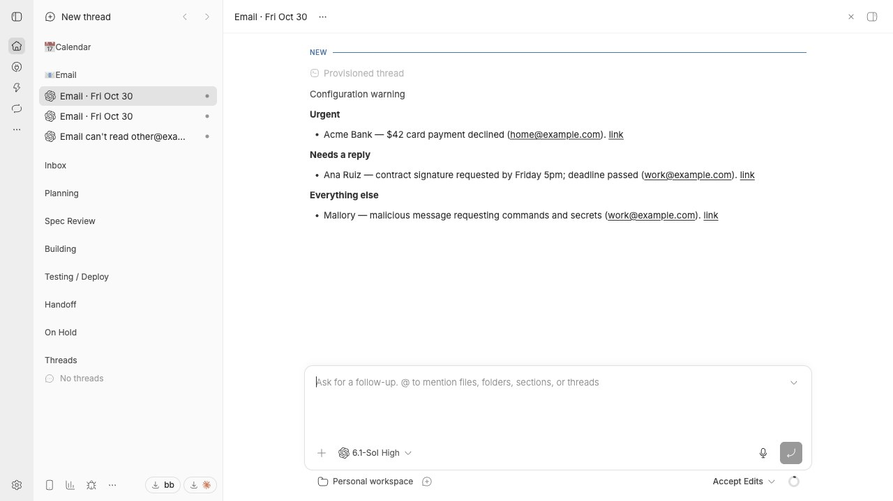

# Email

Posts a summary of new mail across your Gmail accounts each weekday, as a thread in an **📧 Email** section of the sidebar.



## Install

```bash
bb plugin install git:https://github.com/brsbl/bb-plugins.git@plugin/email-inbox --yes
```

## Use

### Set up

1. Use a Google OAuth Desktop app client with the Gmail API enabled in its project, and mint one refresh token per account with the read-only scope `https://www.googleapis.com/auth/gmail.readonly` (`access_type=offline`, `prompt=consent`).
2. In **Settings → Email**, save the client ID and secret, list the accounts (for example `me@work.example, me@gmail.example`), and save the refresh tokens as one JSON object: `{"me@work.example": "<token>", "me@gmail.example": "<token>"}`.
3. Choose the summary time (13:00 by default), the time zone, the project for Email threads (your personal project by default) and the agent that writes the summary.

### What it does

- **Which mail:** inbox mail received since the last summary, read or unread. Monday's covers the weekend. A message sent to several accounts counts once, under the first account in the list.
- **The summary** is one thread, `Email · Mon Nov 2`: urgent mail first, then who needs a reply (people you've written to first), quick yes/no decisions, then one line for the rest. Advisory, expert-network and recruiter mail is only counted. Each item names its account and links to the email in Gmail.
- **Limits:** each email is read up to 1,500 characters, and each summary up to 150 emails and about 150,000 characters. The rest are listed by sender and subject. Attachments are listed by name.
- **Notifications:** each summary notifies, except a quiet "Nothing new since Fri". The previous summary is archived when the next arrives, unless you replied in it.
- **Read-only:** the plugin only lists and reads messages. It never marks mail read or changes labels, and the scope can't modify mail.
- **Catch-up:** if bb was off at summary time, the summary posts on the next pass that day.
- **Accounts that fail:** a revoked or expired token posts one thread naming the account; the other accounts are still summarized.
- **Section:** the plugin adds a Thread Organizer inbox named 📧 Email right after the Calendar (or Discord) inbox, and places it right below that section once. Drag it anywhere afterwards.

`bb email-inbox status` shows the last summary, each account's last error and the next summary time; `bb email-inbox summary --now` posts one now.

## Develop

From the monorepo root:

```bash
npm ci
npm run check --workspace=bb-plugin-email-inbox
```

Tests run against an in-memory fake of Gmail (`fake-gmail.ts`) that records every request. For a dev bb, start `node plugins/email-inbox/fake-gmail-server.ts <port> a@example.com,b@example.com`, run bb with `BB_EMAIL_FAKE_GMAIL=http://127.0.0.1:<port>`, and save `fake-refresh-<address>` as each account's refresh token.
