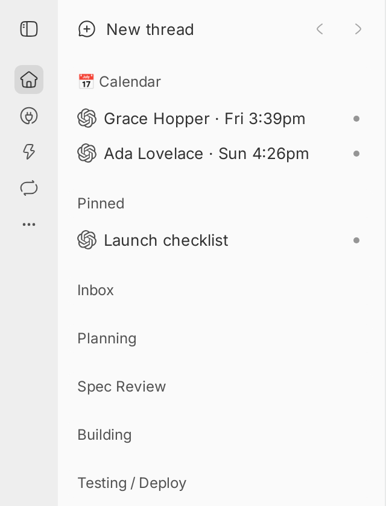

# Calendar

Lists your upcoming Google Calendar events in a **📅 Calendar** section of the sidebar, soonest first, and sends a bb notification when an event is added, moved or canceled, and 10 minutes before it starts.



## Install

```bash
bb plugin install git:https://github.com/brsbl/bb-plugins.git@plugin/calendar --yes
```

## Use

### Set up

1. Create a Google OAuth client and a refresh token for it with the read-only scope `https://www.googleapis.com/auth/calendar.events.readonly`.
2. In **Settings → Calendar**, save the client ID, client secret and refresh token, and list the calendar IDs to read (for example `primary, family@group.calendar.google.com`). A calendar shared with the signed-in account can be read by its ID.
3. Choose the time zone, the project for Calendar threads (your personal project by default) and the agent that writes notifications.

### What it does

- **Which events:** every timed event in the next 7 days on the listed calendars. All-day events and birthdays are skipped.
- **Each event is a thread** titled `Name · Day time`. Booked calls from a Google booking page use the guest's name; other events use their own title. Opening one shows the time, who's on it, Join Meet and the Google Calendar link.
- **Notifications:** when an event is added, moved ("Moved to Thu 2pm") or canceled, and 10 minutes before it starts. Each one is a short agent reply on its thread, so it reaches your phone and open bb windows through bb's push notifications. Events already on the calendar when the plugin starts are listed without a notification.
- **Clean-up:** an entry leaves 30 minutes after its event ends, or right after its cancellation notice.
- **Section:** the plugin adds a Thread Organizer inbox named 📅 Calendar, first in the workflow, and places it above Pinned once. Drag it anywhere afterwards.
- **Order:** each thread carries its event's start time as `sidebarSortKey` in its plugin metadata, for thread lists that sort a section by it.

`bb calendar status` shows the last sync and the listed events; `bb calendar sync` reads Google now. When Google can't be read for an hour, a thread says so.

## Develop

From the monorepo root:

```bash
npm ci
npm run check --workspace=bb-plugin-calendar
```

Tests run against an in-memory fake of Google Calendar (`fake-google.ts`). For a dev bb, start `node plugins/calendar/fake-google-server.ts <port> primary` and run bb with `BB_CALENDAR_FAKE_GOOGLE=http://127.0.0.1:<port>`.
