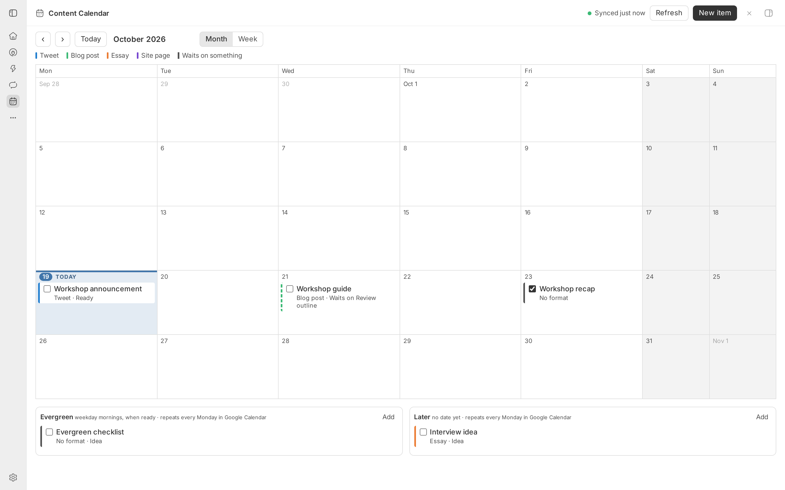

# Content Calendar

Plan deliverables on a month or week calendar. Each new item starts as an all-day event on a dedicated Google calendar named **Content**, so the schedule also shows in Google Calendar and on your phone.



## Install

Install **Content Calendar** from bb’s Community marketplace once listed. Until then, use the source checkout instructions below.

## Use

1. Create a Google OAuth **Desktop app** client in your own Google Cloud project. The steps are in [the plugin skill](skills/content-calendar/SKILL.md#connect-google-one-time).
2. Choose **New calendar time zone** in **Settings → Content Calendar** (an IANA zone such as `Europe/London`; default `UTC`). Existing calendars keep their zone.
3. Save its client ID and secret in **Settings → Content Calendar**, or run `bb content-calendar connect` in a thread for a masked form.
4. Open **Content Calendar** in the sidebar and choose **Connect**. Approve in Google, then paste the address your browser lands on.

- **See the schedule** by month or week. The left rule is the format color, the checkbox means posted, and a dashed rule means the item waits on something.
- **Move items** by dragging, with **Move to…**, the **When** field, or the keyboard (Space, arrows, Space).
- **Undated work** sits in the Evergreen and Later trays. In Google Calendar each tray item repeats every Monday.
- **Attach** links, pull requests, and bb threads. File attachments require a connected machine; see the requirements below.
- **Choose a format** or leave it as **No format**. The browser remembers your last choice; no publishing cadence is imposed.
- **Agents** use `bb content-calendar` and paste `::content-calendar{view="week" start="2026-10-05"}` to show a live calendar inline in chat.

Disconnecting or uninstalling leaves the Content calendar and every item in Google Calendar. `bb content-calendar export` writes every item as JSON.

## Requirements and data

Google Calendar and your own Google Cloud OAuth Desktop app client are required. A fresh install shows connection instructions and disables Connect until client credentials are saved. There is no bundled account, calendar, or credential. Client ID, client secret, refresh token, and calendar ID use secret settings; the time zone is a normal setting.

File attachments require an enrolled, connected machine. Note discovery searches the default Moss notes folder in that machine’s home directory. If the folder is missing, search returns no notes; you can still attach another file by entering its absolute path. Opening notes in Moss requires macOS and Moss installed on that Mac. On other platforms, or when Moss cannot open a note, bb uses its file preview. With no connected machine, file attachments are unavailable; URL, pull request, and thread attachments, scheduling, and Google sync still work.

Item titles, notes, gates, and attachment references are stored in your Google calendar and cached in bb’s plugin database. File attachments store references, not file contents. Treat calendar access as access to that item metadata. Disconnect removes bb’s saved refresh token but leaves the Google calendar and the local cache.

## Develop

From the monorepo root:

```bash
npm ci
npm run check --workspace=bb-plugin-content-calendar
bb plugin install "path:$PWD/plugins/content-calendar" --yes
```

Tests run the sync engine against an in-memory fake of the Google Calendar API (`fake-google.ts`).
