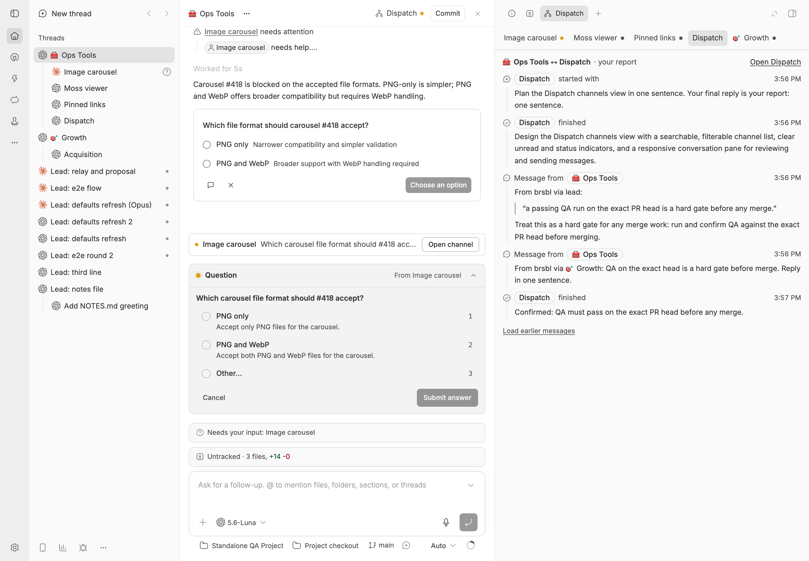
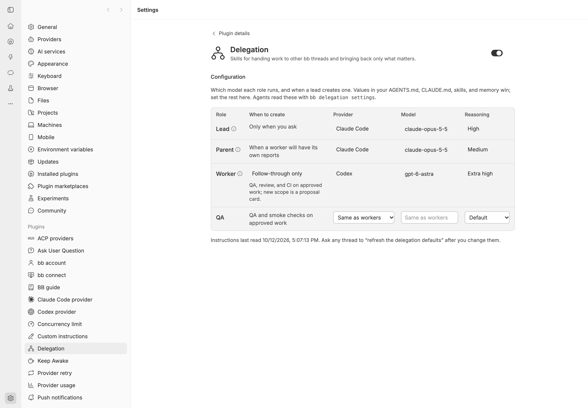

# Dispatch

Skills and a right-panel view for running a team of bb threads: delegate work, keep each agent-to-agent conversation in its own channel, and bring back only what matters.





## Install

```bash
bb plugin install git:https://github.com/brsbl/bb-plugins.git@plugin/delegation --yes
```

## Use

### Channels

Open **Dispatch** from a thread's header or its right-panel launcher. Each agent the thread talks with gets a channel tab: its reports, its lead, and any peer lead that messaged it. A channel is the two-way conversation with that one agent, in order: messages this thread sent, messages it got back, and the agent's results. A grey dot marks new activity, and an orange dot marks an agent waiting on you.

Dispatch only reads what bb already stores. Sent messages come from the receiving thread's timeline, with their persisted delivery state (queued, not delivered, or steered). Channels refresh every 30 seconds while the window is visible, and **Load earlier messages** pages back. Agent messages still appear in the main timeline as bb shows them today.

The plugin ID, the `bb delegation` CLI, the skill names, and the settings keys keep their original `delegation` names.

### Skills

Ask a thread to "launch an agent for this and parent it". The lead starts a worker, the worker does the job and replies once, and the lead passes on only what you need. Each job has one skill:

| Skill | Owns |
| --- | --- |
| `delegate` | Whether to spawn or propose, the worker's tier by role, and a self-contained prompt with its org, scope guardrails, and merge gate |
| `relay` | Passing your decision or request to an existing thread in one batched message that quotes you |
| `collect-results` | Waiting on workers without polling, reading their reports and artifacts, and retrying stalls and provider errors |
| `report-results` | Short, batched reports with evidence inline and decisions as action cards |
| `thread-lifecycle` | Archiving, stopping, handoffs, unparenting, and section moves, following your instructions |
| `delegation-defaults` | Reading your AGENTS.md, CLAUDE.md, skills, and memory into the settings, with quotes |

The skills build on existing ones rather than repeating them: `spawn` for machine capacity and model tiers, `handoff` for transferring work in progress, `comms` for writing style, `inline-action-cards` for cards, `bb-thread-status-report` for every running thread, and `tidy` for post-merge cleanup.

### Settings

Dispatch keeps no rules of its own. Each setting resolves in this order:

1. **Your instructions.** The `delegation-defaults` skill reads `~/.bb/AGENTS.md`, `~/.claude/CLAUDE.md`, your memory notes, and your skills, then records what they say about each setting with the file and your exact words. These win.
2. **Your override**, from Settings → Dispatch or `bb delegation set`. It applies only where your instructions are silent.
3. **A fallback** that defers to bb or the spawn skill.

Settings → Dispatch is one table: a row each for Lead, Parent, Worker, and QA, with when a lead creates that role and its provider, model, and reasoning. Values your instructions set are locked, with the source on hover; an override they outrank is flagged so you can remove it. Every other setting below is read and set with `bb delegation`. Agents read the effective values with `bb delegation settings --json`. Ask any thread to "refresh the delegation defaults" after you change your instructions.

| Setting | Fallback | What it controls |
| --- | --- | --- |
| `provider`, `model`, `reasoningLevel` | blank | Provider, model, and reasoning level for leaf workers (no reports of their own); blank lets spawn's normal tier decide. Changing the provider clears the model. |
| `leadProvider`, `leadModel`, `leadReasoningLevel` | blank | The tier for org leads; blank uses the leaf values. |
| `parentProvider`, `parentModel`, `parentReasoningLevel` | blank | The tier for threads that have reports; blank uses the leaf values. The delegate skill always passes the resolved provider, model, and reasoning explicitly. |
| `avoidModels` | blank | Model IDs no worker should run, comma-separated. |
| `qaProvider`, `qaModel`, `qaReasoningLevel` | blank | The same for QA and smoke-test threads; blank uses the worker values, and `cheapest` picks the cheapest model the provider lists. |
| `machine` | blank | Machine for new workers; blank uses the lead's machine unless spawn's capacity check moves the job. |
| `environment` | blank | `worktree`, `personal`, `lead` to share the lead's environment, or blank for spawn's choice. |
| `section` | blank | Sidebar section for new workers; blank uses the lead's section. |
| `parentWorkers` | on | Parents workers to the lead so bb tells it when they finish, fail, or need input. |
| `workerReportLines` | `3` | Most lines in a worker's final reply (1–20). |
| `reportMaxBullets` | `5` | Most bullets in a report to you (1–20). |
| `reportStyle` | `bullets` | `bullets` for an outcome line and bullets, or `prose` for one short paragraph. |
| `decisionsAsActionCards` | on | Asks for every decision with an inline action card. |
| `evidenceInline` | on | Shows screenshots and videos in the report instead of describing them. |
| `relayBatching` | `batch` | `batch` sends each thread one combined message; `each` sends requests as they come. |
| `retryLimit` | `2` | Retries of a worker's failed turn, such as a provider 429, before it's reported as blocked (0–10). |
| `mayArchiveOrStop` | off | On: a lead stops and archives bounded workers it started once their work is handed back; standing reports are never archived. Off: only when you ask. |
| `spawnPolicy` | `ask` | When a lead may spawn without asking: `ask` (never), `followthrough` (QA, review, CI repair, and checks on approved work), `approved` (anything inside approved scope), or `free`. Anything else becomes a proposal card. |
| `reportTo` | `lead` | Whether workers report, and raise decisions, to their lead or to you directly. |

### Commands

```bash
bb delegation settings [--json] [--explain]
bb delegation set <key> <value>
bb delegation reset <key>
bb delegation sources [--json]
bb delegation record <key> <value> --from <file> --quote <words> [--note <text>] [--host <host id>]
bb delegation forget <key> | --all [--host <host id>]
bb delegation children [--thread <lead-id>] [--json]
bb delegation cascade [--thread <id>] [--json]
```

`settings` prints the effective values and where each comes from; `set` and `reset` change your override. `sources`, `record`, and `forget` manage the values read from your instructions; `--host` records which machine's files they came from, and only that machine refreshes them. `children` lists a lead's workers, most urgent first: `needs-input`, `error`, `host-offline`, `retry-queued`, `working`, or `idle`. `cascade` lists every thread that `bb thread archive` would also archive: children, threads it is the lifecycle owner of, and hidden forks, recursively. Both default to the current thread.

## Develop

From the monorepo root:

```bash
npm ci
npm run check --workspace=bb-plugin-delegation
bb plugin install "path:$PWD/plugins/delegation" --yes
```
