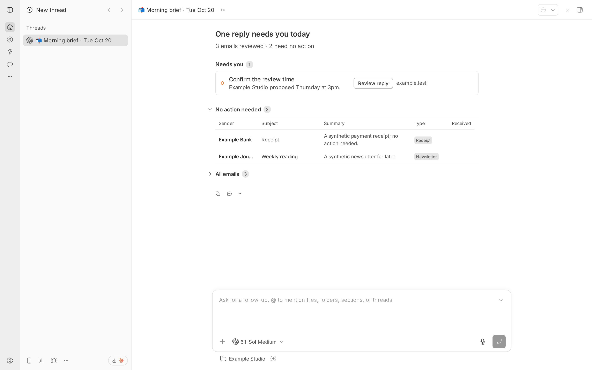
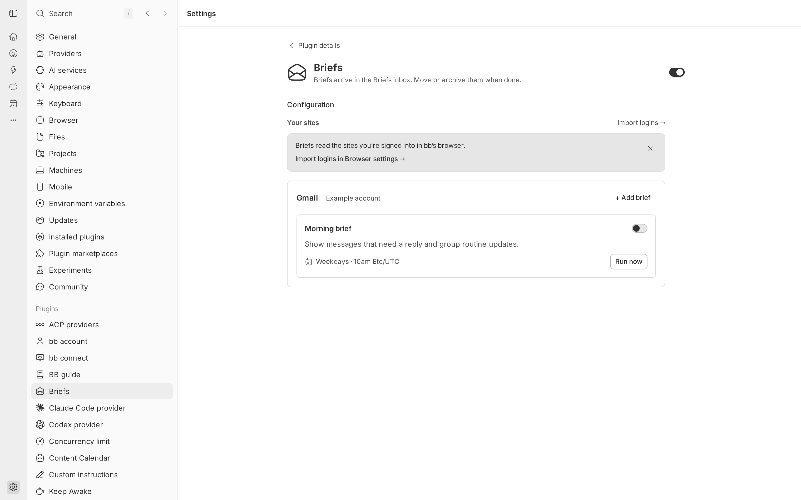
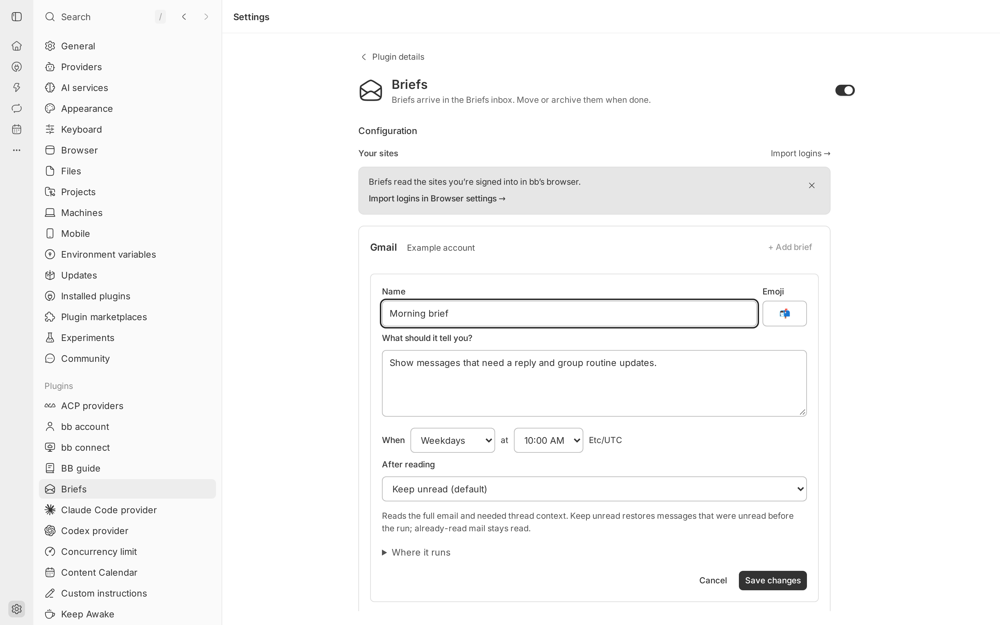

# Briefs

Private briefings delivered as threads: one clear headline, a few numbered
items with buttons that open where each task gets done, each email in one brief only, and a flat “No action needed” email table collapsed. Briefs arrive in a
Briefs inbox. Archive them when done and find old briefs with thread search.







## Requirements

- **Automations** schedules and dispatches brief runs.
- **Browser Automation** lets the collecting agent read fresh, brief-owned tabs
  using your BB Browser sign-ins.
- **Thread Organizer** must support additional inboxes (`role: "inbox"` and
  `catchesPluginId`) to create and route the Briefs inbox.
- **bb 0.45.0 or later** on both the browser desktop and connected server is
  required for collection. Keep the browser computer connected and configure
  an agent provider/model; runs use that provider's account and usage allowance.
- Sign in to each source you choose (Gmail, X, or LinkedIn) in BB Browser.
  Briefs does not supply service accounts or copy cookies.

Install the required plugins before setting up Briefs. The current plugin
manifest contract has no field for declaring dependencies on other plugins;
these requirements are checked through the setup and connection flows.
Inline Decisions is optional for proposals that need your approval.

## Install

Install **Briefs** from the Community marketplace once listed, or use its
published Git install ref with `bb plugin install`.

## Use

Open **Settings → Plugins → Briefs**. Import logins through bb’s own Browser
settings if needed. Sign-ins are checked automatically when Settings opens and before every run. Under a signed-in site, choose **Add
digest**, give it a name, describe what it should tell you, and choose when.
Create turns it on; **Run now to preview** opens the first brief. Click a digest’s
name to edit it in place. Runs use a Personal workspace on the computer with your browser sign-ins. If needed, choose a project and computer under **Where it runs**.

Agent setup can prefill the following ordinary prompt digests from the existing
recipes. These start disabled until you confirm migration. Existing automations
are never adopted or changed.

| Starter brief | Default time |
| --- | --- |
| Unread email | Weekdays, 10am |
| Money | Monday, 10am |
| Reading | Sunday, 11am |
| X scorecard | Published by another thread |

Starter setup uses the bb server’s system timezone. New briefs created in
Settings use your browser’s timezone, shown beside the time. Saved prompts and
schedules keep their existing values. Edit starter prompts to add your interests.

Setup creates a Briefs inbox that catches this plugin’s
briefs. Read and unread briefs stay there until you move or archive them.

Browser collection requires **bb 0.45.0 or later** on the browser desktop and
connected server. Fresh brief-owned tabs reuse your existing BB Browser sign-ins.
No cookie copying or permanently open tab is needed. A computer or workspace that cannot start a run shows a persistent error with Retry on its brief card. Older runtimes show an
update-needed brief. Signed-out connections show Reconnect; unavailable or
interrupted runs show Retry. A missed run is reported when bb resumes.

Gmail collection reads every matching email in full, including every message in a thread, and never summarizes from list previews. **After reading** defaults to **Mark as read**, including saved definitions without a preference. Read messages are left read, with their final state checked in bounded batches. Choose **Keep unread** to preserve each message’s original state; full-body print access avoids changing mixed or unknown read states. The picker is available under every Gmail account. Explicit saved preferences are retained.

Briefs may mark fully read messages read or restore their original unread state. It never sends, archives, labels, or deletes mail. A per-message journal tracks read-state changes across interruptions; incomplete reading or unverified state is reported. Other sites are read-only. Gmail message IDs are recorded as processed only after successful publication, so each email appears in one brief.
Optional Inline Decisions provide click-approved proposals; without that
plugin, actions are plain text and nothing is executed.

Other threads can publish a prepared report:

```bash
bb digest publish --digest x-scorecard --file brief.md --key 2026-10-05
```

Use `bb digest --help` for setup, custom definitions, connection checks, and
publishing options. Brief content, definitions, and processed IDs stay in
Briefs' private storage, never thread storage. External publication uses a
brief native agent turn to put the visual summary into its new thread.

## Develop

From the monorepo root:

```bash
npm ci
bb plugin install "path:$PWD/plugins/digests" --yes
```

CI runs `npm run check --workspace=bb-plugin-digests` remotely. Use an isolated
bb development app with synthetic fixtures for browser and screenshot verification.

Digest cards keep the name prominent, with a muted schedule at the bottom-left opposite Run now. Edit your own prompt in place; collection rules and Gmail searches live in the runtime, never in the prompt preview. A small emoji field beside the name controls the prefix on new brief thread titles. Saved definitions fall back to their starter emoji when none is set.

## Verification boundary

`service.test.ts` uses mocked Browser Automation, desktop tabs, and Automations
with a synthetic mailbox to cover both after-reading modes, mixed-state reply
chains, failed restoration, and interrupted runs. The journal stores what the
agent reports; it does not operate Gmail or independently verify a click.
The collecting agent must restore and verify message state through its browser
session. These tests do not prove compatibility with Gmail's current live UI.
Never use a personal mailbox, browser profile, or account for release QA.
