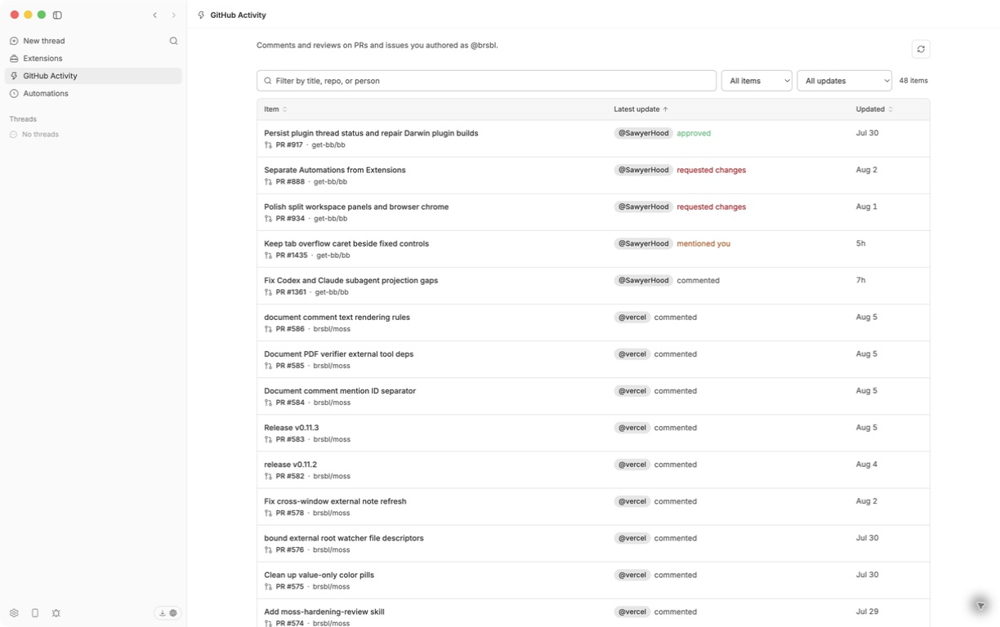

# GitHub Activity

GitHub Activity adds a BB sidebar panel for comments and mentions on pull requests and issues you authored.



## Use

The feed uses the account already authenticated in the GitHub CLI. It keeps only incoming comments and mentions on resources authored by that account, then presents one searchable, filterable, and sortable table with separate resource and activity icons, repository, title, actor, and recency.

BB hosts the page beside its native Browser and Terminal tools. Each row remains a normal GitHub link, so standard link behavior and modifiers are preserved.

## Install

```bash
bb plugin install git:https://github.com/brsbl/bb-plugins.git@plugin/github-notifications --yes
```

Install the GitHub CLI on the machine running the bb server and sign in there:

```bash
gh auth login
gh auth status
```

If the CLI is missing or signed out, the panel shows setup guidance. After signing in, choose **Try again**. Credentials remain with the GitHub CLI.

## Develop

Run the focused package check from the repository root:

```bash
npm run check --workspace=bb-plugin-github-notifications
```
