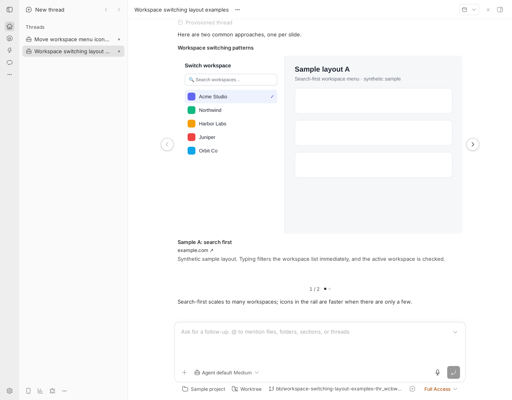
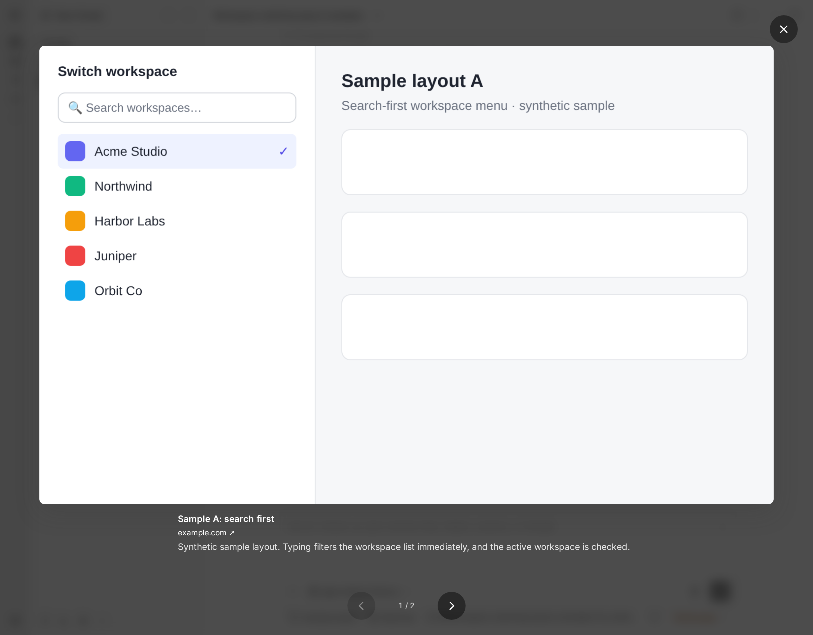
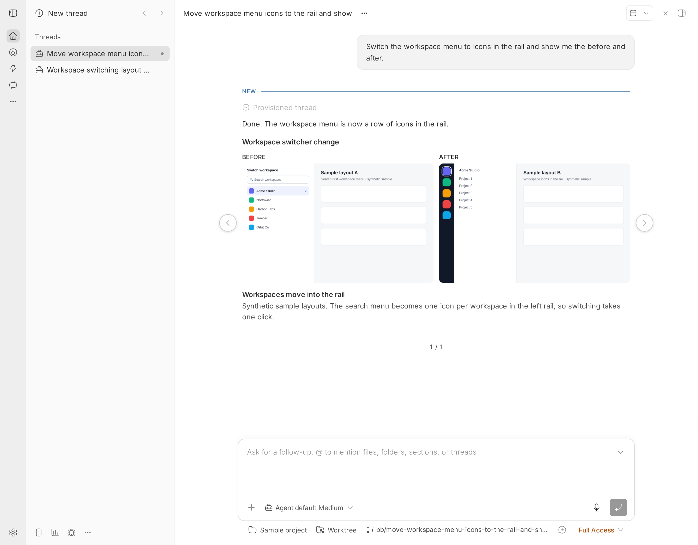
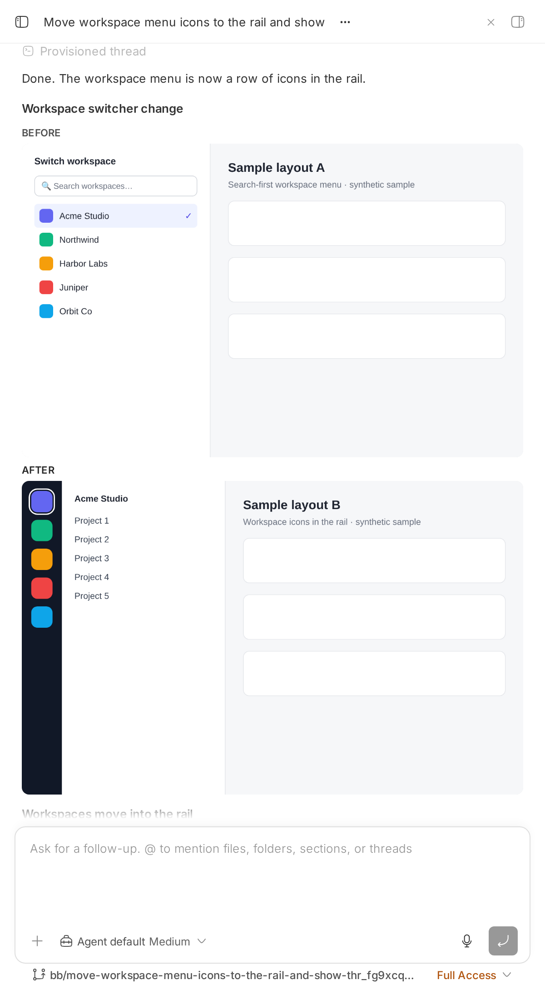

# Image Carousel

Show screenshots inline in a bb thread as a carousel, one slide at a time, with arrows in the image’s side margins and the description below.









## Install

```bash
bb plugin install git:https://github.com/brsbl/bb-plugins.git@plugin/image-carousel --yes
```

## Use

Agents create a carousel with `bb image-carousel create` and put the `::image-carousel{id="…"}` directive it prints in their reply. The bundled skill covers when and how. There are two kinds:

- **research**: one image per slide with a title, description, and source link. For comparing how other products handle a design problem.
- **before-after**: Before and After shown side by side, with one shared title and description, advancing a pair at a time. For reviewing UI changes without a long screenshot table.

The heading, images, caption, and centered "2 / 5" position use the full chat-column width. The arrows sit outside the image in the left and right chat margins. In narrow panes or layouts without spare side margins, they move beside the centered counter below the caption, leaving the images full width. Titles and source links stay visible above a two-line description preview. Show more opens the full description over the image without resizing it. Every image sits in the same 16:10 frame. Click an image to browse the full set at full size, with its caption, source link, and image position. Use Previous/Next, Left/Right arrow keys, or swipe on touch; Escape, the close button, or a click outside dismisses the viewer. Before/after sets browse Before then After for each slide, and closing returns to the current slide. Arrow keys also work when the inline carousel has focus. In narrow panels, After stacks below Before and navigation stays beside the counter.

Images are read from the thread's machine and copied into the plugin's own database when the carousel is created. A carousel keeps working after its source files, worktree, or thread are cleaned up, and in forks of the thread. `bb image-carousel remove <id>` deletes it, along with any image copies no other carousel uses.

## Develop

From the monorepo root:

```bash
npm ci
npm run check --workspace=bb-plugin-image-carousel
bb plugin install "path:$PWD/plugins/image-carousel" --yes
```
