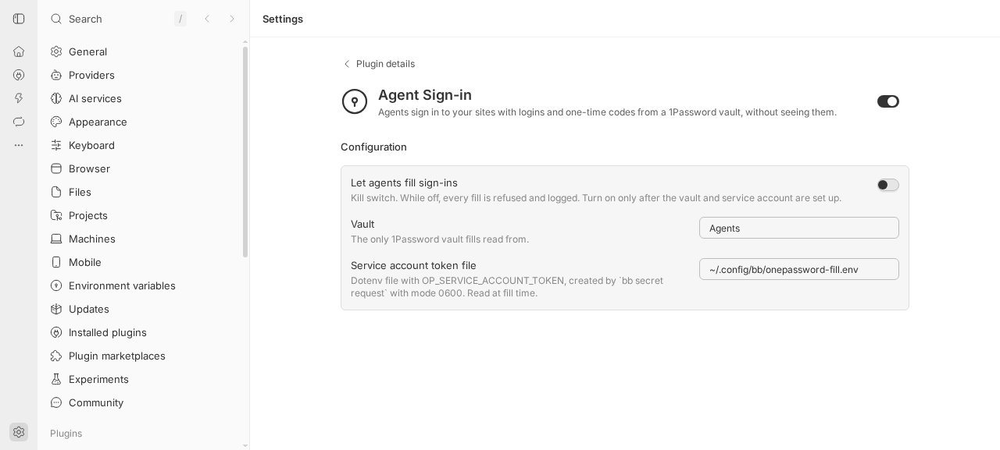
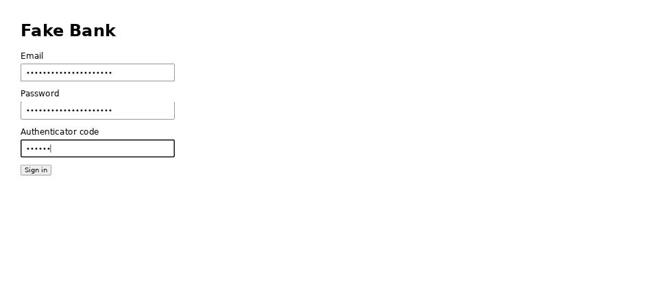

# Agent Sign-in

Agents sign in to your sites with logins and one-time codes from a 1Password
vault, without seeing them. An agent asks for a field by login name, and the
plugin types it into the agent's Browser Automation page. The agent only gets
back `ok` or an error code.





## Install

```bash
bb plugin install git:https://github.com/brsbl/bb-plugins.git@plugin/onepassword-fill --yes
```

Requires a bb whose Browser Automation has the plugin-only `experimental_fill`
RPC. Older bb versions return `browser_unavailable`.

## Use

One-time setup:

1. In 1Password, create a vault named **Agents** and add a Login item for each
   site, with its sign-in URL saved as a website. To use one-time codes, switch
   the site from SMS to an authenticator app and save the setup key in the
   item's one-time password field.
2. Create a service account with **read-only** access to the Agents vault only.
3. Save its token on the bb server host without showing it to an agent:

   ```bash
   bb secret request OP_SERVICE_ACCOUNT_TOKEN --write-env ~/.config/bb/onepassword-fill.env \
     --purpose "1Password service account for Agent Sign-in"
   ```

4. Turn on **Let agents fill sign-ins** in Settings → Agent Sign-in. It is off
   by default, and turning it off again stops every fill at once.

Agents then sign in with the `onepassword_fill` tool or the CLI:

```bash
bb 1password fill --session <session-id> --item "TaxAct" --field password --selector '#password'
bb 1password fill --session <session-id> --item "TaxAct" --field otp --selector '#code'
bb 1password log
```

### What protects the values

- **The token.** It is read from the 0600 dotenv file at each fill and passed
  straight to the official 1Password SDK, in memory. It is never put in
  `process.env`, argv, logs, or output. A file other users can read is refused.
- **Vault scope.** Fills read only the configured vault by name, and only
  through read calls. The service account's own read-only scope is the hard
  limit.
- **Origin binding.** The page must be HTTPS and on the same registrable domain
  (Public Suffix List) as one of the login's saved websites. Otherwise the
  fill is refused before the field is read. Browser Automation re-checks the
  page's origin in the same step as typing, so a navigation cannot redirect the
  value.
- **One-time codes.** A code is generated from the item's one-time password
  field at fill time. If it would expire within five seconds, the fill waits
  for the next one.
- **Outputs.** The agent, CLI, and log see only `ok` or a fixed error code with
  a hint. The value reaches only Browser Automation's plugin-only fill RPC.
  Browser Automation masks it in later snapshots, `evaluate` results,
  screenshots, and previews.
- **Audit log.** Every attempt records the time, thread, login name, field,
  page origin, and result, never a value. `bb 1password log` shows the log.

Settings: **Let agents fill sign-ins** (default off), **Vault** (default
`Agents`), and **Service account token file** (default
`~/.config/bb/onepassword-fill.env`).

## Develop

From the monorepo root:

```bash
npm ci
npm run check --workspace=bb-plugin-onepassword-fill
bb plugin install "path:$PWD/plugins/onepassword-fill" --yes
```

The build copies the 1Password SDK's WebAssembly core into `dist/` next to the
bundle, after checking its pinned SHA-256. Tests use a stubbed vault and fake
items only.
