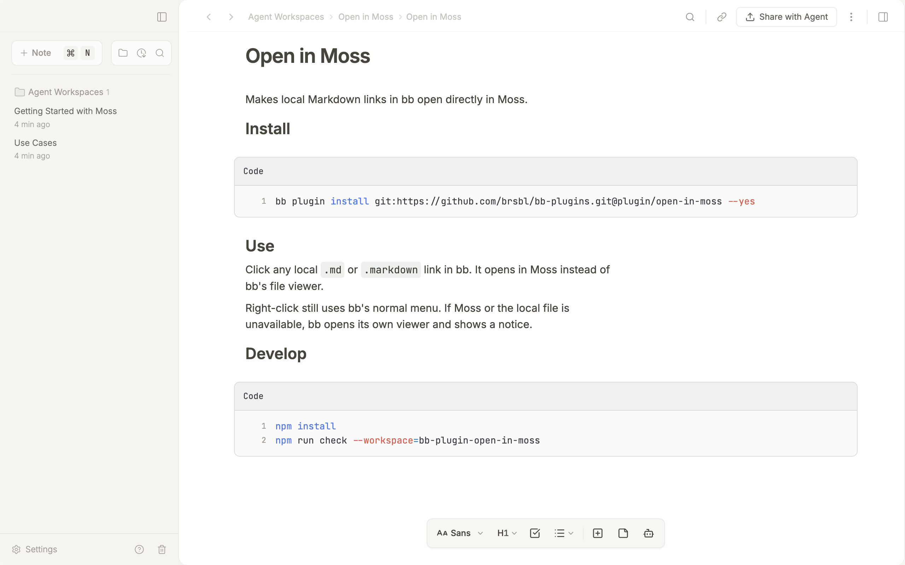
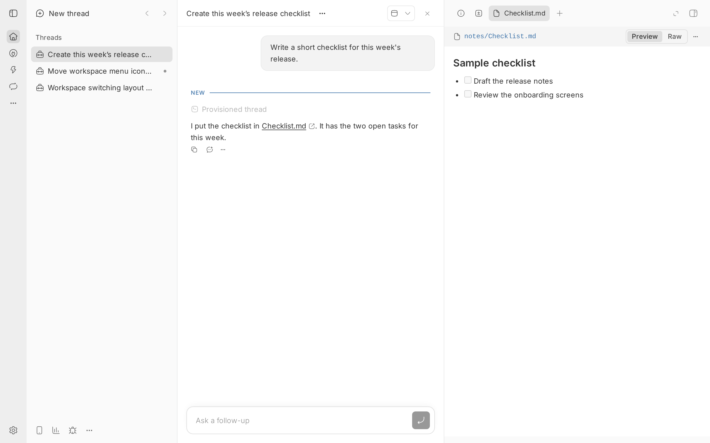

# Open in Moss

Makes local Markdown links in bb open directly in Moss.

**Requires Moss on the Mac that holds the file, and bb 0.43.4 or newer.**
If bb runs elsewhere, that Mac must be connected. If Moss or the file is
unavailable, the link falls back to bb’s file viewer.





## Install

```sh
bb plugin install git:https://github.com/brsbl/bb-plugins.git@plugin/open-in-moss --yes
```

## Use

Click any local `.md` or `.markdown` link in bb. It opens in Moss instead of
bb's file viewer.

Requires bb 0.43.4 or newer. On a Mac bb server, files on that Mac open
directly. Otherwise the connected hosts are checked and the file opens in Moss
on the Mac that has it; if several Macs have the same path, the host with the
lowest ID is used. A host that can't be reached doesn't block the others. If no
connected Mac has the file, bb opens it instead.

The existing `POST /api/v1/plugins/open-in-moss/http/open` endpoint also accepts
a `path` and optional `hostId` to target the file’s host directly.
Omit `hostId` for automatic discovery.

When the Moss Viewer plugin is enabled, Open in Moss steps aside and links open
in bb's file preview, where Moss Viewer renders them.

Right-click still uses bb's normal menu. If Moss or the local file is
unavailable, bb opens its own viewer and shows a notice.

## Develop

```sh
npm install
npm run check --workspace=bb-plugin-open-in-moss
```
