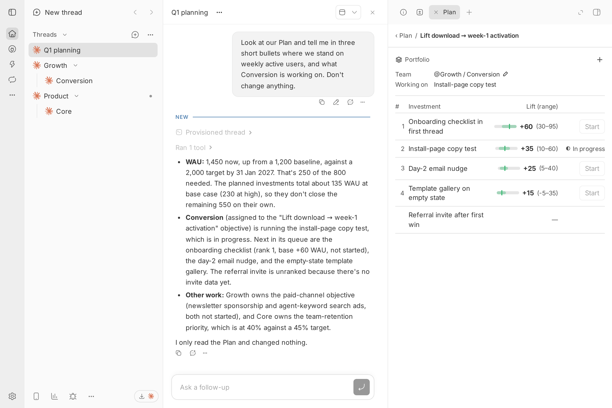

# Plan

Plan company priorities, objectives and ranked portfolios beside the agent, then start one investment at a time per team.



## Install

```bash
bb plugin install git:https://github.com/brsbl/bb-plugins.git@plugin/plan --yes
```

## Use

Plan keeps shared planning records that you and the agent beside you both edit: company priorities, the objectives under each, and the investments that make up each objective's portfolio. Agents use the `plan` tool; people and scripts use `bb plan`. Both run the same validation.

```bash
bb plan show
bb plan priority add "Grow weekly active users" --metric "weekly active users" --baseline 1200 --now 1450 --target 2000 --by 2027-01-31
bb plan priority edit <priority-id> --format percent --expected-revision 2
bb plan objective add <priority-id> "Lift download to week-1 activation" --assign <team-thread-id>
bb plan objective approve <objective-id> --expected-revision 1
bb plan objective assign <objective-id> --thread <team-thread-id> --expected-revision 2
bb plan investment add <objective-id> "Install-page copy test" --existing --deliverable "Winning copy shipped"
bb plan investment edit <investment-id> --scope "Copy only" --expected-revision 1
```

- Every edit, approve and assign takes `--expected-revision`. An edit based on an older revision is rejected, never applied over a newer one.
- Records save with fields missing. Add `--json` to any command for machine-readable output.
- Assigning stores an existing org or team thread's ID; the name shown is read from the thread. Adding or assigning a record sends nothing and wakes no thread.
- Objectives an agent proposes (`--proposed`) stay unapproved until adopted with `approve`.
- Lift and investment state are not editable through `edit`.
- `show` includes `openInPanel`: the record open in the calling thread's Plan panel (an objective or investment page, or the priority last edited there), or null.
- A priority's `--format` (`number` or `percent`) sets how its values display; it is inferred from the metric name (a `%` or "retention" means percent) unless set.
- In the panel, the metric pencil edits the baseline, now, target, metric name, format, date and constraints together. The team field's suggestions read "Org / Team"; choose Unassign, or clear it to "@", to unassign.

## Research

Adding a priority, approving and assigning an objective, adding an investment, or editing a record queues research. Research is batched: each objective has at most one portfolio research run at a time, and investment adds or reruns that arrive while one is queued or running fold into a single follow-up run that covers all of them. Edits under the same objective (or to the same priority) within 120 seconds of each other produce one edit assessment covering every changed record and field. Plan runs each request itself: two independent research threads, then one reconciliation thread once both submissions are saved. Research, reconciliation and assessment threads are hidden from bb's thread list; open them from an investment's "Open both submissions" links or with `bb plan research show`. Only a valid reconciliation reaches the records. Lift is written only by that publish step, and the rank is computed from base lift.

- Each request's inputs are frozen when it starts: both research threads and the reconciliation get the same brief. If a lift-relevant input changes before the reconciliation (a priority's metric, baseline, target or date, an objective's priority, or an investment's scope or existing flag), the request is superseded, nothing publishes, and a fresh run is queued. Renames, wording, constraints and a priority's current value don't supersede; they go to the edit assessment.
- An agent decides whether an edit needs fresh research. Editing a lift-relevant field puts the affected objectives on hold: lift stays visible, Start is unavailable ("Checking whether this edit changes the research"), and the edit assessment starts without the 120-second quiet window. Closing it releases the hold and keeps lift and rank; rerunning it clears lift and rank for the named objectives and queues their refresh. Holds are stored, so they survive restarts.
- Ranking compares only investments on the same unit, period and population. Only the main comparable group is ranked; others, and every item while any disagreement is unresolved, stay unranked with the reason under the investment's missing evidence.
- Portfolio research writes each investment's brief (deliverable, scope, acceptance criteria, measurement, sources), plus its cost and dependencies even when it can't be sized. It never overwrites a brief field set by hand.

```bash
bb plan research list [--phase researching] [--json]
bb plan research show <request-id>
bb plan research submit --request <request-id> --slot a --file submission.json
bb plan research reconcile --request <request-id> --data-stdin < reconciliation.json
bb plan research close --request <request-id> --reason "Rename only"
bb plan research rerun --request <request-id> --objective <objective-id> --reason "Target changed"
```

- `submit`, `reconcile`, `close` and `rerun` are for the research threads Plan creates, and are rejected from any other thread or with no calling thread; the method skills (`discover-objectives`, `build-portfolio`, `calculate-lift`, `reconcile-research`, `assess-edit`) describe the JSON each takes. A rejection lists every problem to fix.
- Settings: `researchProjectId` is the project for research threads (default: the project of the thread the priority or objective was created in, then the project of the plan's first assigned team thread; otherwise the request is blocked and the panel says so on that priority or objective). `researchConcurrency` caps requests in flight (default 2).

## Start and Done

Start sends an investment's saved brief (deliverable, scope, acceptance criteria, measurement, sources, and the command to report back) to its objective's team thread and marks it In progress. The panel's Start button, `bb plan investment start` and the `investment_start` tool action run the same check and send.

```bash
bb plan investment start --id <investment-id>
bb plan investment mark-in-progress --id <investment-id>
bb plan investment deliver --id <investment-id> --output delivery.json
```

- Start needs checked, ranked lift, an approved objective whose team thread still exists, a complete brief (deliverable, scope, acceptance criteria one per line, measurement and sources), and a team with nothing In progress under any objective. Each missing item is listed in the error.
- `mark-in-progress` (tool: `investment_mark_in_progress`, panel: Mark in progress on the investment page) sets an investment marked existing to In progress without sending a brief, for activity already running. It works from the panel, the CLI and the agent beside the panel, only for existing, not-started investments, and obeys the one-per-team rule. Deliver it as usual.
- A team is its assigned thread. Only one of its investments can be starting or In progress at a time; two clicks or a click and a CLI call can't start two.
- When bb doesn't confirm the send, the Start stays reserved; starting again checks the team thread's messages before sending, so the brief is never sent twice. A refused send frees the team and shows the error.
- `deliver` works only from the team thread the brief went to, or one of its workers. `--output` is JSON (inline or a file path) with `deliverable`, one `{ "criterion", "evidence" }` entry for every acceptance criterion, and `measurement` when the brief has one. A valid delivery marks the investment Done and frees the team; the next investment never starts on its own.

## Develop

From the monorepo root:

```bash
npm ci
npm run check --workspace=bb-plugin-plan
bb plugin install "path:$PWD/plugins/plan" --yes
```
