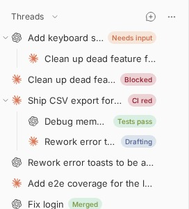

# Thread Status

Short, color-coded status pills beside sidebar thread titles, kept current by
agents. Also moves the expand/collapse caret on parent threads to the left of
the row.



## Install

```bash
bb plugin install git:https://github.com/brsbl/bb-plugins.git@plugin/thread-status --yes
```

## Use

Agents receive instructions to keep their thread's pill current. Set it from
any agent thread:

```bash
bb thread-status set "CI red" --tone danger
bb thread-status clear
bb thread-status get --json
```

Tones are `neutral`, `info`, `success`, `warning` and `danger`, drawn from the
theme's semantic colors. Labels are 1-2 words, at most 18 characters.
Archiving or deleting a thread clears its pill.

The pill complements Thread Organizer: the section names the workflow stage and
the pill says what is true within it.

## Develop

From the monorepo root:

```bash
npm ci
npm run check --workspace=bb-plugin-thread-status
bb plugin install "path:$PWD/plugins/thread-status" --yes
```
